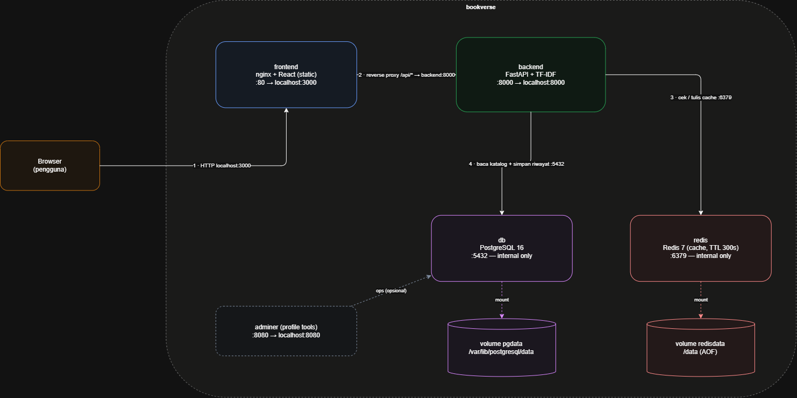
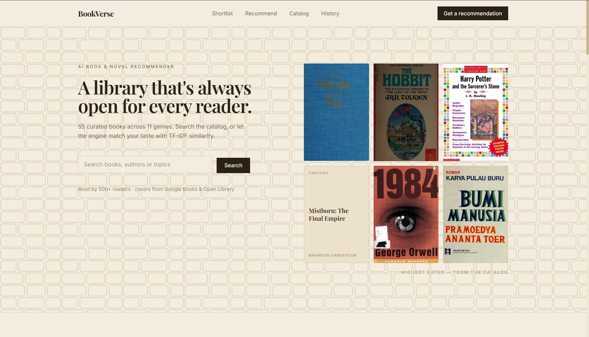
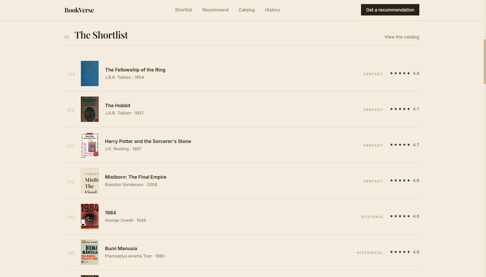
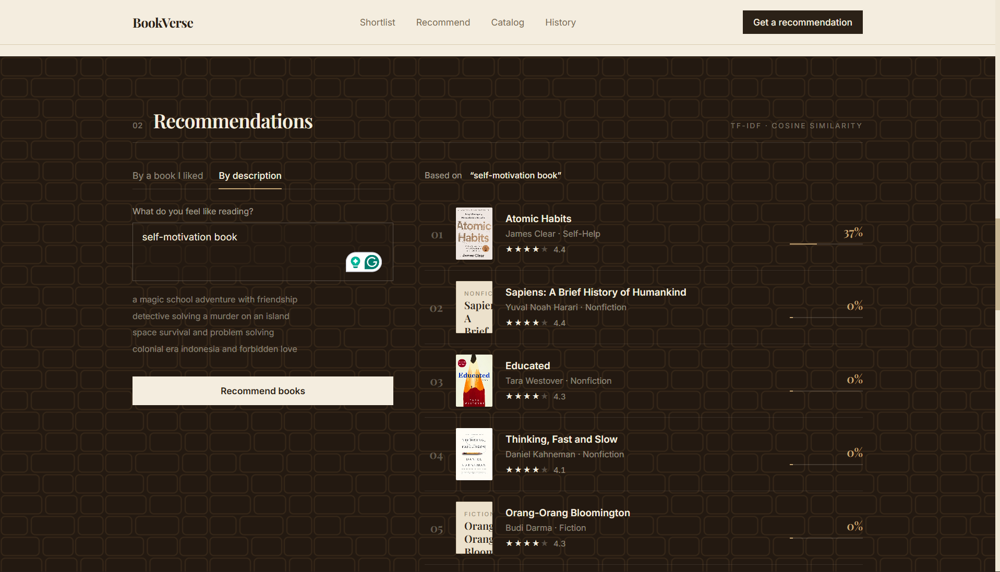

# 📚 BookVerse — Rekomendasi Buku & Novel Berbasis AI

BookVerse adalah **aplikasi web kategori AI** yang merekomendasikan buku dan
novel memakai **content-based filtering (TF-IDF + cosine similarity)**, dibangun
sebagai aplikasi multi-tier cloud-native yang berjalan penuh di **Docker
Compose** pada localhost.

> Projek akhir **UTS COMP6991031 — Cloud Computing** (aplikasi multi-tier +
> containerization). Kategori: **AI** · Fitur inti (MVP): *rekomendasi buku
> cerdas dari judul atau deskripsi bebas*.

Link Artikel: https://medium.com/@ahmadhilmitamaam15/bookverse-a-dockerized-ai-book-recommender-eb43a41aaa56
Link Video: https://youtu.be/wrj1wXSCOSw

---

## ✨ Fitur

- **Rekomendasi AI** — pilih buku yang kamu suka, atau tulis deskripsi bebas
  tentang apa yang ingin kamu baca; mesin mengembalikan 6 buku paling mirip
  lengkap dengan skor kemiripan.
- **Katalog** — 55 buku & novel kurasi (internasional + Indonesia) dengan
  pencarian dan filter genre.
- **Riwayat rekomendasi** — setiap prediksi disimpan di PostgreSQL, jadi data
  tetap aman saat restart (named volume).
- **Cache Redis** — rekomendasi yang berulang dilayani dari cache (lihat badge
  ⚡ di UI).
- **Start satu perintah** — `docker compose up -d --build` dan selesai.

## 🏗️ Arsitektur



| Tier | Container | Teknologi | Port (host) |
|------|-----------|-----------|-------------|
| Frontend | `frontend` | React 18 + Vite + Tailwind CSS, disajikan **nginx** (reverse-proxy `/api`) | **3000** |
| Backend | `backend` | **FastAPI** + Uvicorn + SQLAlchemy + scikit-learn (TF-IDF) | **8000** |
| Database | `db` | **PostgreSQL 16** (named volume `pgdata`) | internal |
| Cache | `redis` | **Redis 7** (named volume `redisdata`) | internal |
| DB admin | `adminer` | Adminer — hanya dengan `--profile tools` | 8080 |

Semua container terhubung ke **user-defined network** (`booknet`) dan saling
memanggil dengan **nama service** (mis. `postgresql://...@db:5432/...`), bukan
localhost/IP.

## 🔌 Endpoint API

| Method | Path | Deskripsi | Sukses |
|--------|------|-----------|--------|
| GET  | `/health` | Liveness probe (cek PostgreSQL + Redis) | `200` |
| GET  | `/api/books` | Baca katalog (`?search=`, `?genre=`) | `200` |
| POST | `/api/predict` | Rekomendasi AI; hasil di-cache di Redis, riwayat ditulis ke PostgreSQL | `201` |
| GET  | `/api/history` | Baca riwayat rekomendasi terbaru | `200` |

```bash
# Endpoint READ
curl http://localhost:8000/api/books

# Endpoint WRITE (rekomendasi AI dari judul)
curl -X POST http://localhost:8000/api/predict \
  -H "Content-Type: application/json" \
  -d '{"query": "The Hobbit", "mode": "title"}'

# Endpoint WRITE (mode teks bebas)
curl -X POST http://localhost:8000/api/predict \
  -H "Content-Type: application/json" \
  -d '{"query": "magic school adventure with friendship", "mode": "text"}'

# Riwayat (bukti persistensi)
curl http://localhost:8000/api/history
```

Dokumentasi interaktif: <http://localhost:8000/docs> (Swagger UI).

## 🚀 Cara Menjalankan

Prasyarat: **Docker Desktop** (Engine ≥ 20) — tanpa yang lain.

```bash
git clone https://github.com/Hilmee15/bookverse.git
cd bookverse
cp .env.example .env        # nilai dummy saja, tanpa rahasia
docker compose up -d --build
```

Lalu buka:

- **Aplikasi**: <http://localhost:3000>
- **Dokumentasi API**: <http://localhost:8000/docs>
- **Adminer** (opsional): `docker compose --profile tools up -d` → <http://localhost:8080>
  (System: PostgreSQL · Server: `db` · User/Password/DB: lihat `.env.example`)

Perintah berguna:

```bash
docker compose ps                 
docker compose logs -f backend    
docker compose down               
docker compose down -v            
```

## 📁 Struktur Projek

```
├── docker-compose.yml        # 5 service, network, volume, healthcheck, profile
├── .env.example              # template yang di-commit (.env asli di-gitignore)
├── backend/
│   ├── Dockerfile            # multi-stage: builder (venv) -> runtime (slim)
│   ├── requirements.txt      # versi ter-pin
│   └── app/
│       ├── main.py           # aplikasi FastAPI + endpoint
│       ├── recommender.py    # mesin TF-IDF + cosine similarity
│       ├── models.py         # model SQLAlchemy (books, history)
│       ├── database.py       # setup engine/session
│       └── seed_data.py      # dataset awal 55 buku
└── frontend/
    ├── Dockerfile            # multi-stage: build node -> runtime nginx
    ├── nginx.conf            # routing SPA + reverse proxy /api
    └── src/                  # komponen React + Tailwind
```

## 📸 Screenshot





## 🔗 Tautan

- **Artikel**: https://medium.com/@ahmadhilmitamaam15/bookverse-a-dockerized-ai-book-recommender-eb43a41aaa56
- **Video demo**: https://youtu.be/wrj1wXSCOSw

## ⚖️ Kredit

- Framework & library: FastAPI, React + Vite, Tailwind CSS, SQLAlchemy,
  scikit-learn, nginx, PostgreSQL, Redis — semuanya open source.
- Katalog awal: data bibliografis publik (judul/penulis/sinopsis ditulis untuk
  projek ini). Tidak ada API key pihak ketiga atau layanan berbayar.

## 🤖 Deklarasi Penggunaan AI

During the development of the BookVerse project, artificial intelligence (AI) was transparently utilized as a technical collaboration assistant (AI collaborator) to support development efficiency:

Scope of AI Assistance:

- Assisting in building the website: project scaffolding, UI components, and styling for the React frontend and FastAPI backend.
- Providing reference structures and best practices for writing multi-stage builds in the Dockerfile and orchestration configurations in docker-compose.yml (healthchecks, named volumes, and user-defined networks).
- Assisting with debugging and troubleshooting when encountering issues running Docker commands or testing endpoints.

Developer Responsibility and Contribution:

- The project theme, topic selection, book catalog curation, recommendation approach, and this article were independently decided and written by the developer.
- All architectural design decisions, code validations, local verification testing, and final adjustments were independently executed and tested by the developer.
- The developer takes full responsibility for the functional correctness, security, and thorough understanding of all source code published in this repository, and can explain every Dockerfile and docker-compose line in the demo video.
