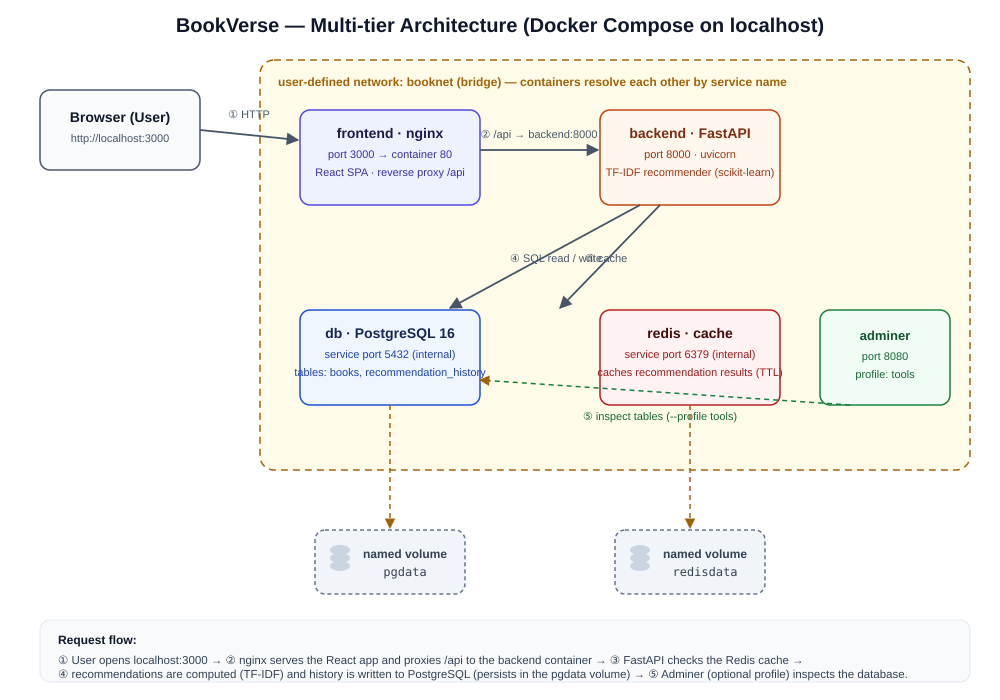

# 📚 BookVerse — AI Book & Novel Recommender

BookVerse is a small **AI-category web application** that recommends books and
novels using **content-based filtering (TF-IDF + cosine similarity)**, built as
a cloud-native multi-tier app that runs entirely on **Docker Compose** at
localhost.

> Final project for **UTS COMP6991031 — Cloud Computing** (multi-tier app +
> containerization). Category: **AI** · Core feature (MVP): *smart book
> recommendation from a title or free-text description*.

---

## ✨ Features

- **AI recommendations** — pick a book you liked, or describe what you feel
  like reading; the engine returns the 6 closest matches with a match score.
- **Browse catalog** — 55 curated books & novels (international + Indonesian)
  with search and genre filters.
- **Recommendation history** — every prediction is stored in PostgreSQL, so
  data survives restarts (named volume).
- **Redis cache** — repeated recommendations are served from cache (look for
  the ⚡ badge in the UI).
- **Single-command startup** — `docker compose up -d --build` and you're done.

## 🏗️ Architecture



| Tier | Container | Tech | Port (host) |
|------|-----------|------|-------------|
| Frontend | `frontend` | React 18 + Vite + Tailwind CSS, served by **nginx** (reverse-proxies `/api`) | **3000** |
| Backend | `backend` | **FastAPI** + Uvicorn + SQLAlchemy + scikit-learn (TF-IDF) | **8000** |
| Database | `db` | **PostgreSQL 16** (named volume `pgdata`) | internal |
| Cache | `redis` | **Redis 7** (named volume `redisdata`) | internal |
| DB admin | `adminer` | Adminer — only with `--profile tools` | 8080 |

All containers are attached to a **user-defined network** (`booknet`) and talk
to each other by **service name** (e.g. `postgresql://...@db:5432/...`), never
by localhost/IP.

## 🔌 API Endpoints

| Method | Path | Description | Success |
|--------|------|-------------|---------|
| GET  | `/health` | Liveness probe (checks PostgreSQL + Redis) | `200` |
| GET  | `/api/books` | Read catalog (`?search=`, `?genre=`) | `200` |
| POST | `/api/predict` | AI recommendation; result cached in Redis, history written to PostgreSQL | `201` |
| GET  | `/api/history` | Read recent recommendation history | `200` |

```bash
# READ endpoint
curl http://localhost:8000/api/books

# WRITE endpoint (AI recommendation by title)
curl -X POST http://localhost:8000/api/predict \
  -H "Content-Type: application/json" \
  -d '{"query": "The Hobbit", "mode": "title"}'

# WRITE endpoint (free-text mode)
curl -X POST http://localhost:8000/api/predict \
  -H "Content-Type: application/json" \
  -d '{"query": "magic school adventure with friendship", "mode": "text"}'

# History (proof of persistence)
curl http://localhost:8000/api/history
```

Interactive docs: <http://localhost:8000/docs> (Swagger UI).

## 🚀 How to Run

Requirements: **Docker Desktop** (Engine ≥ 20) — nothing else.

```bash
git clone https://github.com/<your-username>/bookverse.git
cd bookverse
cp .env.example .env        # dummy values only, no secrets
docker compose up -d --build
```

Then open:

- **App**: <http://localhost:3000>
- **API docs**: <http://localhost:8000/docs>
- **Adminer** (optional): `docker compose --profile tools up -d` → <http://localhost:8080>
  (System: PostgreSQL · Server: `db` · User/Password/DB: see `.env.example`)

Useful commands:

```bash
docker compose ps                 # all services + health status
docker compose logs -f backend    # tail API logs
docker compose down               # stop; data SURVIVES (named volumes kept)
docker compose down -v            # stop AND delete volumes (fresh database)
```

## 📁 Project Structure

```
├── docker-compose.yml        # 5 services, network, volumes, healthchecks, profile
├── .env.example              # committed template (real .env is git-ignored)
├── backend/
│   ├── Dockerfile            # multi-stage: builder (venv) -> runtime (slim)
│   ├── requirements.txt      # pinned versions
│   └── app/
│       ├── main.py           # FastAPI app + endpoints
│       ├── recommender.py    # TF-IDF + cosine similarity engine
│       ├── models.py         # SQLAlchemy models (books, history)
│       ├── database.py       # engine/session setup
│       └── seed_data.py      # 55-book seed dataset
└── frontend/
    ├── Dockerfile            # multi-stage: node build -> nginx runtime
    ├── nginx.conf            # SPA routing + /api reverse proxy
    └── src/                  # React + Tailwind components
```

## 📸 Screenshots

| Description | Image |
|-------------|-------|
| `docker compose ps` — all services healthy | `docs/screenshots/compose-ps.png` *(add)* |
| UI — Hero & catalog | `docs/screenshots/ui-home.png` *(add)* |
| UI — Recommendation results | `docs/screenshots/ui-recommend.png` *(add)* |
| curl `/health` → 200, `/api/predict` → 201 | `docs/screenshots/curl.png` *(add)* |
| Persistence after `down` + `up -d` | `docs/screenshots/persistence.png` *(add)* |

## 🐳 Bonus: Push to Docker Hub

```bash
docker login
docker compose build
docker tag bookverse-backend  <your-username>/bookverse-backend:1.0.0
docker tag bookverse-backend  <your-username>/bookverse-backend:latest
docker tag bookverse-frontend <your-username>/bookverse-frontend:1.0.0
docker tag bookverse-frontend <your-username>/bookverse-frontend:latest
docker push <your-username>/bookverse-backend:1.0.0
docker push <your-username>/bookverse-backend:latest
docker push <your-username>/bookverse-frontend:1.0.0
docker push <your-username>/bookverse-frontend:latest
```

## 🔗 Links

- **GitHub**: this repository
- **Article**: *(add after publishing — Medium/dev.to/Hashnode, 500–800 words)*
- **Video demo**: *(add after uploading — YouTube, 3–5 min, public)*

## ⚖️ Credits

- Framework starters & libraries: FastAPI, React + Vite, Tailwind CSS,
  SQLAlchemy, scikit-learn, nginx, PostgreSQL, Redis — all open source.
- Seed catalog: public bibliographic data (titles/authors/synopses written
  for this project). No third-party API keys or paid services are used.

## 🤖 AI Usage Declaration

> This project was completed under the course's **Partial AI** policy
> (AI assistance ≤ 50%). Fill in honestly before submitting.

| Item | Detail |
|------|--------|
| AI tools used | *(e.g. ZCode / GLM)* |
| Parts assisted by AI | *(e.g. project scaffolding, Dockerfile & compose boilerplate, UI styling, debugging)* |
| Parts done by me | *(e.g. choosing/understanding the architecture, dataset curation, testing, video, article, report)* |
| Example prompts | 1) *(add)* 2) *(add)* |

All Dockerfile / docker-compose lines were reviewed, tested, and can be
explained by the author in the demo video.
